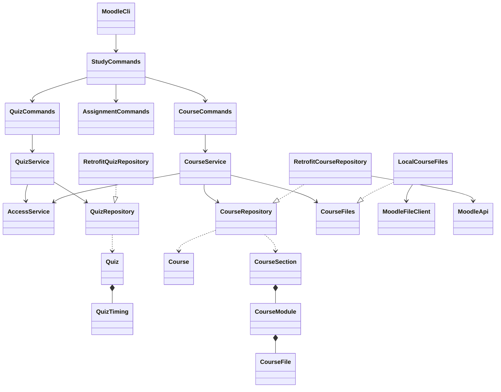

# Architecture

[Project overview](../README.md) · [Development](DEVELOPMENT.md) · [Specification](SPEC.md)

## Dependency boundaries

Use one Gradle module with separate packages. The domain owns the models and the
contract for retrieving Moodle data. Application services depend on this contract.
Infrastructure implements it using Retrofit. The CLI handles input and presentation.



`CourseService` handles authenticated course operations and selection of activities
and files. `AccessService.withSession` supplies the verified user ID and in-memory
token, and removes credentials when an operation reports expired authentication.
`TokenStore` supplies an optional native persistence boundary. `AccessService`
validates candidates before saving and verifies stored tokens before activating a
session. `endSession` clears only process state; `logout` also removes persistence.
`MacKeychainTokenStore` uses Apple's SecItem APIs through JNA; its Core Foundation
dictionaries own and release their native references. `WindowsCredentialTokenStore`
uses generic per-user Credential Manager entries. The composition root selects the
platform adapter; neither adapter invokes a shell or silently falls back to a file.
`CourseRepository` and `CourseFiles` are replaceable boundaries. Application services
do not depend on Retrofit, response DTOs, filesystem APIs, or terminal output.
`AssignmentService` depends on `AssignmentRepository` and `AccessService` for
assignment listing and optional submission details. `RetrofitAssignmentRepository`
uses the capabilities recorded at login to skip unsupported status requests.
`AssignmentList.partial` preserves API warnings without retaining their remote text.
Individual extensions are applied before deadline filtering; `Clock` makes window
boundaries and local-time presentation deterministic. `StudyCommands` dispatches
course, assignment, and quiz commands consistently in both CLI entry paths.

`QuizService` and `QuizRepository` keep quizzes separate from assignments.
`RetrofitQuizRepository` reads quiz metadata without accessing attempt endpoints.
`QuizTiming` distinguishes an unrestricted schedule from metadata that Moodle did
not expose (`Quiz.timing == null`). `TerminalDates` provides the same local date,
UTC offset, and zone formatting for both assignment and quiz commands. `assignments`
is an alias of `tasks`; quiz closing times are not merged into `upcoming`.

`RetrofitCourseRepository` maps course DTOs into domain models. `MoodleFileClient`
restricts credential-bearing requests to the configured Moodle file endpoint and
sends the token in the POST body without following redirects. `LocalCourseFiles`
handles bounded streaming, safe filenames, exclusive file creation, and cleanup
of failed downloads. `PlainText` parses HTML locally with jsoup and removes
terminal controls; it does not fetch embedded resources.

`MoodleApplication.kt` composes the shared adapters and services. `Main.kt` selects
the terminal or local MCP entry point and connects its presentation adapters. Secrets stay in the running process.
Keep secrets out of generated `toString()` output, including configuration data classes.

## Constructor injection

Pass dependencies explicitly through constructors. No dependency injection library
or global service locator is required. The following is a design sketch:

```kotlin
class AssignmentService(
    private val access: AccessService,
    private val repository: AssignmentRepository,
    private val clock: Clock
)
```

Use the JDK `Clock` to make deadline filtering deterministic in tests. Tests supply
a fake repository and a fixed clock without contacting Moodle. The production
repository is separately responsible for API response mapping and error translation.

An interface is useful at an external boundary that we need to replace in tests.
Ordinary services and models remain concrete classes. Split the repository contract
by feature if authentication, downloads, or other capabilities make it too broad.

## Kotlin implementation conventions

- Prefer `val`, read-only collection interfaces, and data classes for domain values.
  Read-only collections do not by themselves guarantee immutable backing storage.
- Model missing values with nullable types; avoid `!!`.
- Use primary constructors and private dependencies; use properties instead of
  Java-style accessor methods.
- Keep functions focused, with explicit return types at architectural boundaries.
- Use top-level functions for small stateless helpers and extension functions only
  when they improve readability.
- Prefer composition; Kotlin classes remain final unless inheritance is needed.
- Represent distinct application failures with a small sealed hierarchy when error
  handling is implemented. Choose one consistent propagation approach, and do not
  turn failures into empty result lists.
- Repository methods are synchronous. The MCP boundary runs them on interruptible
  IO workers, with at most four active tool calls per server. The CLI stays synchronous.
- Keep output in the CLI and networking in infrastructure. Allow the CLI output
  function to be supplied in tests when output verification is needed.

Follow the official [Kotlin coding conventions](https://kotlinlang.org/docs/coding-conventions.html)
and [data class documentation](https://kotlinlang.org/docs/data-classes.html).

## Scope

Keep the initial design small: no interface for every class, generic base repository,
or separate Gradle module per layer. Credential storage and downloads have their
own replaceable boundaries without introducing additional application modules.

## Browser login responsibilities

`BrowserLoginService` validates the login attempt and callback; `LoginAttempt` is
its separate state type. The browser implementation has three concrete parts:

- `IsolatedChromeLoginBrowser` coordinates opening a page and waiting for the callback.
- `ChromeProcess` owns the process, private pipes, temporary profile, and cleanup.
- `ChromeLoginPage` configures one browser tab and reads its expected callback link.

`ChromeTransport` is the replaceable process boundary. `UnixChromeTransport` uses
inherited file descriptors. `WindowsChromeTransport` uses native anonymous pipes,
a restricted inherited-handle list, and a job object that owns the browser process
tree. Windows profiles are created atomically with a protected, current-user-only DACL.

`ChromePipe` handles bounded protocol messages and response matching. `MoodleCallbackPage`
contains the scoped capture scripts. These classes keep transport and process details
inside infrastructure. The private browser, callback validation, and credential
lifetime remain as described in [Authentication](AUTHENTICATION.md).

API DTOs live under `infrastructure/api/dtos`. Mapping to domain types is kept in
`ApiMappers.kt`. Domain enums, including `SubmissionStatus`, belong under `domain/enums`;
domain entities must not depend on infrastructure.

## Localized presentation

The CLI owns `Messages`, which loads JDK `ResourceBundle` properties and formats
parameterized text with `MessageFormat`. English resources are the fallback;
German resources cover German locales. Global `--lang de|en` is parsed at startup
and one `Messages` instance is injected into CLI components. The JVM's global
locale is never changed.

`MoodleException` carries a stable message key and safe formatting arguments.
Domain, application, and infrastructure code do not load resources or select a
language. The CLI translates errors at the output boundary. Programmer assertions
and protocol identifiers stay separate from user-facing text. Remote Moodle
messages are still sanitized rather than displayed directly. IDs are formatted
without digit grouping so they can be copied into commands.

When adding a message, add the same key and numbered placeholders to both resource
files. Keep properties UTF-8; escape literal apostrophes as `''` for MessageFormat.
Course content is not translated. Command names are the same in both languages.

## MCP presentation boundary

The optional local MCP server reuses `AccessService`, `CourseService`,
`AssignmentService`, and `QuizService`. It introduces no MCP dependency into domain
or application code. `MoodleMcpServer` owns the official SDK's stdio lifecycle;
`MoodleMcpTools` bounds concurrent calls with a coroutine semaphore and translates failures. `MoodleQueries` routes
only explicitly supported queries and local course-file downloads, while `McpContent` constructs bounded
output from an allowlist of fields. `McpArguments` enforces validation independently
of the client's JSON Schema handling.

The CLI and MCP adapters share `PlainText` under `presentation/`; neither renderer
fetches embedded HTML resources. MCP file metadata omits protected resource URLs.
The server loads the existing saved login without exposing authentication tools
or accepting arbitrary upstream URLs/functions. See [MCP](MCP.md) for the protocol,
plugin packaging, and privacy boundary when course content enters Codex context.

Concurrent MCP calls share an immutable session snapshot. `AccessService` locks
credential-store operations and initial session restoration, but executes study
requests outside that lock. Session generations prevent a delayed authentication
failure from deleting a newer login; a delayed health response cannot restore an
ended session. Authentication invalidation affects future calls; requests already
using a snapshot may still finish.
