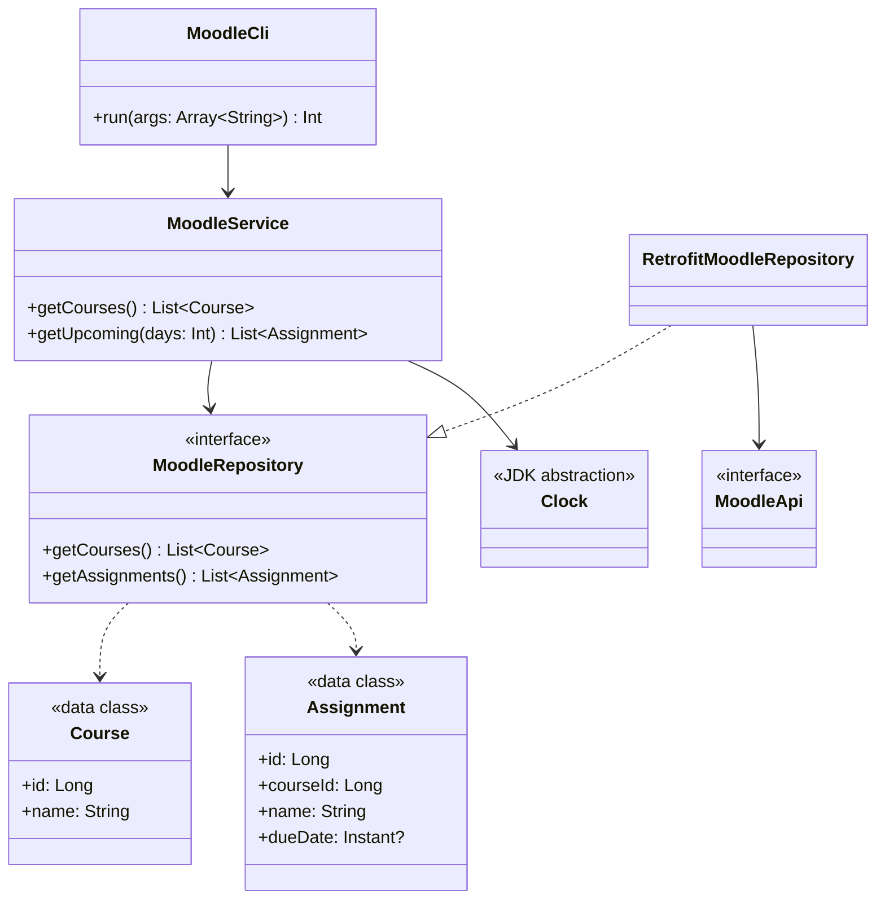

# Architecture

## Dependency boundaries

Use one Gradle module with separate packages. The domain owns the models and the
contract for retrieving Moodle data. Application services depend on this contract.
Infrastructure implements it using Retrofit. The CLI handles input and presentation.



The diagram shows application-level operations, not finalized Moodle endpoints.
`MoodleApi` will use Retrofit annotations and transport-specific response DTOs.
`RetrofitMoodleRepository` maps those DTOs into domain models and translates API
failures into application errors without exposing HTTP response types to callers.
Retrofit creates the implementation of `MoodleApi`.

`Main.kt` is the composition root: it loads configuration, builds Retrofit, creates
the repository and service, then starts the CLI. Configuration and credentials
belong at the integration boundary; services do not load files or look up tokens.
Keep secrets out of generated `toString()` output, including configuration data classes.

## Constructor injection

Pass dependencies explicitly through constructors. No dependency injection library
or global service locator is required. The following is a design sketch:

```kotlin
class MoodleService(
    private val repository: MoodleRepository,
    private val clock: Clock
)
```

Use the JDK `Clock` to make deadline filtering deterministic in tests. Tests supply
a fake repository and a fixed clock without contacting Moodle. The production
repository is separately responsible for API response mapping and error translation.

An interface is useful at an external boundary that we need to replace in tests.
Ordinary services and models remain concrete classes. Split the repository contract
by feature if authentication, downloads, or other capabilities make it too broad.

## Kotlin implementation conventions

- Prefer `val`, read-only collection interfaces, and data classes for domain values.
  Read-only collections do not by themselves guarantee immutable backing storage.
- Model missing values with nullable types; avoid `!!`.
- Use primary constructors and private dependencies; use properties instead of
  Java-style accessor methods.
- Keep functions focused, with explicit return types at architectural boundaries.
- Use top-level functions for small stateless helpers and extension functions only
  when they improve readability.
- Prefer composition; Kotlin classes remain final unless inheritance is needed.
- Represent distinct application failures with a small sealed hierarchy when error
  handling is implemented. Choose one consistent propagation approach, and do not
  turn failures into empty result lists.
- Begin with sequential requests and synchronous repository methods. Introduce
  coroutines when asynchronous work is required, consistently across the call path.
- Keep output in the CLI and networking in infrastructure. Allow the CLI output
  function to be supplied in tests when output verification is needed.

Follow the official [Kotlin coding conventions](https://kotlinlang.org/docs/coding-conventions.html)
and [data class documentation](https://kotlinlang.org/docs/data-classes.html).

## Scope

Keep the initial design small: no interface for every class, generic base repository,
or separate Gradle module per layer. Add credential storage and download boundaries
when those features are implemented.

## Browser login responsibilities

`BrowserLoginService` validates the login attempt and callback; `LoginAttempt` is
its separate state type. The browser implementation has three concrete parts:

- `IsolatedChromeLoginBrowser` coordinates opening a page and waiting for the callback.
- `ChromeProcess` owns the process, private pipes, temporary profile, and cleanup.
- `ChromeLoginPage` configures one browser tab and reads its expected callback link.

`ChromePipe` handles bounded protocol messages and response matching. `MoodleCallbackPage`
contains the scoped capture scripts. These classes keep transport and process details
inside infrastructure. The private browser, callback validation, and credential
lifetime remain as described in [Authentication](AUTHENTICATION.md).

API DTOs live under `infrastructure/api/dtos`. Mapping to domain types is kept in
`ApiMappers.kt`. Domain enums, including `SubmissionStatus`, belong under `domain/enums`;
domain entities must not depend on infrastructure.
